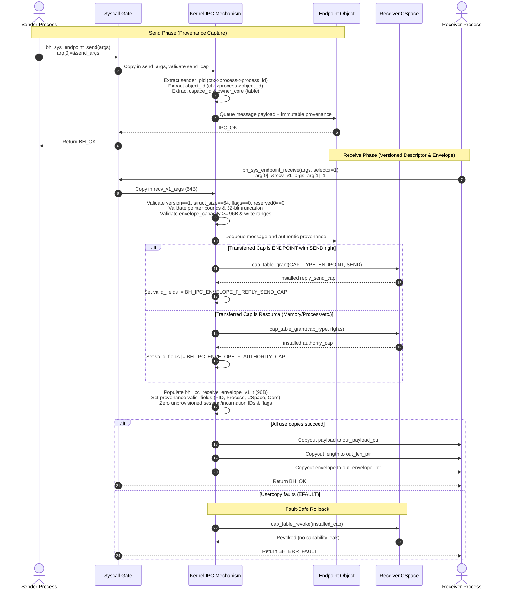
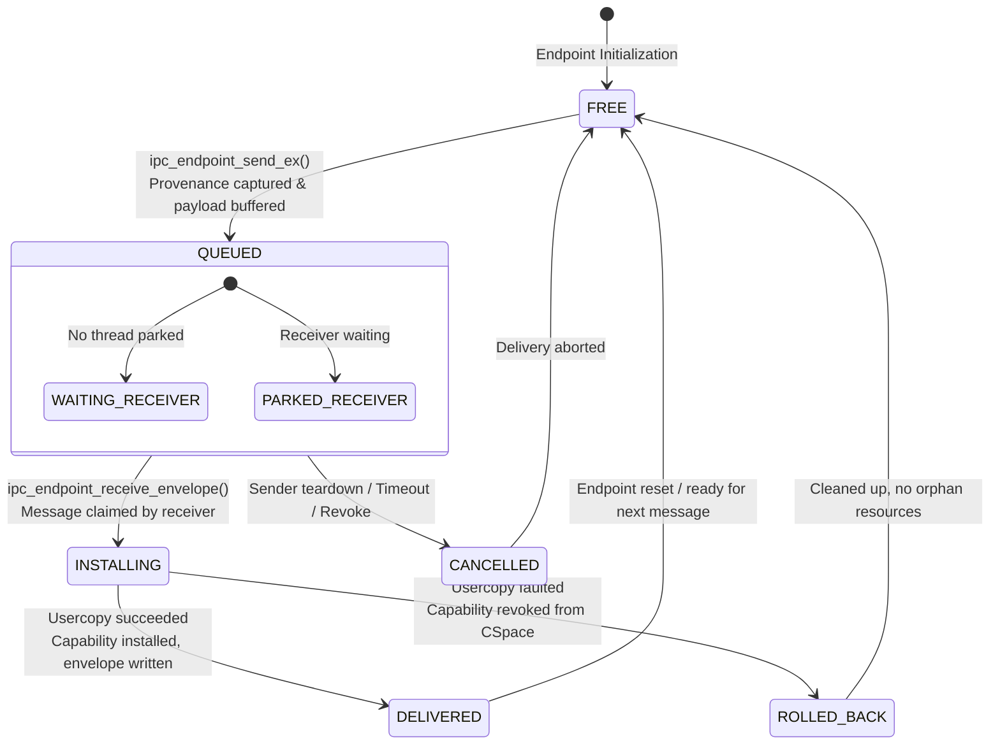
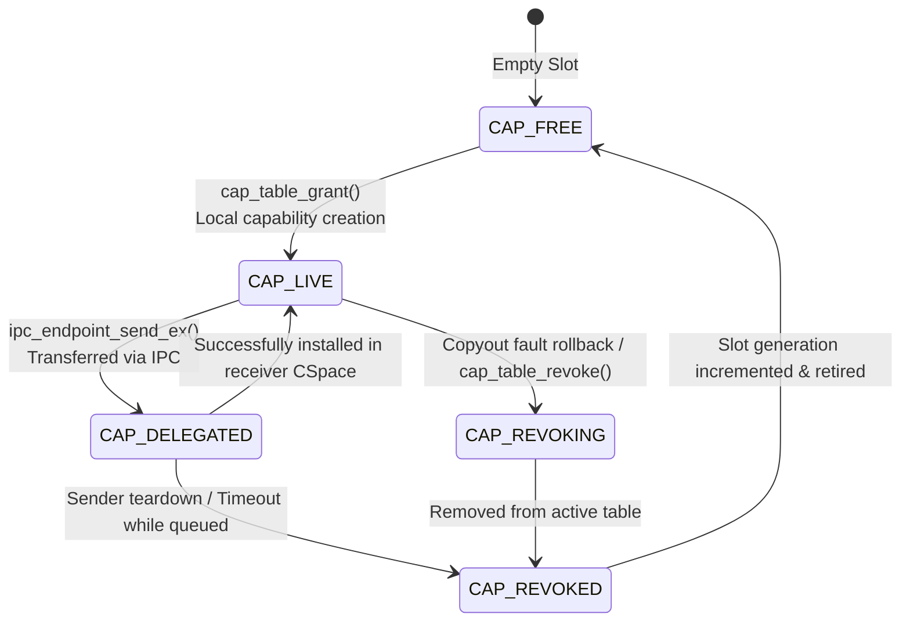

# Authenticated IPC Receive Envelope Architecture (IPC-P0-002)

**Status**: Implemented & Verified (October 2026)  
**Constitutional Authority**: [AGENTS.md](../../AGENTS.md)  
**Specification Reference**: [docs/architecture/p0-ipc-envelope-proposal.md](p0-ipc-envelope-proposal.md)  
**Canonical UAPI**: [interface/include/bharat/uapi/ipc/envelope.h](../../interface/include/bharat/uapi/ipc/envelope.h)  
**Syscall Manifest**: [interface/contracts/abi/native_syscalls.json](../../interface/contracts/abi/native_syscalls.json)  

---

## 1. Architectural Overview & Design Principles

In Bharat-OS's capability microkernel architecture, untrusted userland payloads must never be relied upon to assert identity, rights, or provenance. Prior to IPC-P0-002, capability transfers and wire headers could communicate untrusted integer handles or unauthenticated sender metadata, requiring defensive fail-closed policy shims (ADR-039).

IPC-P0-002 introduces the **kernel-authenticated receive envelope**:
1. **Provenance Captured at Send Acceptance**: The kernel captures authentic sender metadata (`process_id`, `object_id`, `cspace_id`, `owner_core`) directly from the trusted syscall context (`ctx->process` and `ctx->process->security_sandbox_ctx`) in trusted kernel memory at message acceptance.
2. **Untrusted Payloads Separated from Provenance**: The sender-written message payload is delivered alongside, but strictly separated from, a kernel-generated, fixed-width 96-byte receive envelope (`bh_ipc_receive_envelope_v1_t`).
3. **Dual Syscall Dispatch via Selector**: Native Syscall 9 (`BH_SYS_ENDPOINT_RECEIVE`) preserves the exact 40-byte legacy carrier when `arg[1] == 0` (`BH_IPC_RECEIVE_SELECTOR_LEGACY`), and invokes the authenticated 64-byte versioned carrier descriptor when `arg[1] == 1` (`BH_IPC_RECEIVE_SELECTOR_V1`).
4. **Single Capability Role Disambiguation**: Single capability transfers are classified by the kernel upon receipt:
   - If the capability is `CAP_TYPE_ENDPOINT` with `CAP_RIGHT_ENDPOINT_SEND`, it is installed into the receiver's CSpace as `reply_send_cap` (`BH_IPC_ENVELOPE_F_REPLY_SEND_CAP`).
   - Any other capability type is installed as `authority_cap` (`BH_IPC_ENVELOPE_F_AUTHORITY_CAP`) with descriptive `authority_object_type` and `authority_rights`.
   - Reply send capabilities can never be relabeled as service authority tokens.
5. **Never Fabricate Unprovisioned Identity**: Where kernel-backed provisioning does not yet exist (`boot_session_id`, `service_incarnation_id`), fields remain strictly `0` and their associated validity flags remain cleared.
6. **Fault-Safe Copyout Rollback**: If usercopy of payload, length, or envelope fails, any newly installed capability in the receiver's CSpace is immediately revoked (`cap_table_revoke`), preventing handle leaks and orphaned capabilities.

---

## 2. Sequence Diagram: Authenticated IPC Send and Receive

The following sequence diagram details the end-to-end authenticated IPC transmission, provenance capture, versioned receive dispatch, capability role mapping, and copyout fault rollback:



---

## 3. State Diagrams

### 3.1 IPC Delivery & Provenance Lifecycle State Machine

A message and its bound kernel provenance traverse deterministic lifecycle states within the per-core microkernel:



### 3.2 Capability State Machine During Transfer

Capability entries inside process-owned CSpaces transition across these states:



---

## 4. Syscall Dispatch Decision Tree

Syscall 9 (`BH_SYS_ENDPOINT_RECEIVE`) uses register `arg[1]` as a scalar selector to provide backward compatibility for legacy carriers while enabling the authenticated versioned envelope:

```mermaid
flowchart TD
    Start([Syscall 9: BH_SYS_ENDPOINT_RECEIVE]) --> CheckSelector{Check arg[1] Selector}

    %% Legacy Path
    CheckSelector -->|selector == 0<br/>BH_IPC_RECEIVE_SELECTOR_LEGACY| LegacyCopyIn[Copy in legacy 40B args<br/>bharat_sys_endpoint_receive_args_t]
    LegacyCopyIn --> LegacyLookup[Lookup recv_cap with CAP_RIGHT_ENDPOINT_RECEIVE]
    LegacyLookup --> LegacyRange[Validate payload, len, and cap write ranges]
    LegacyRange --> LegacyReceive[ipc_endpoint_receive]
    LegacyReceive --> LegacyCopyOut[Copyout payload, len, received_cap]
    LegacyCopyOut --> LegacyFaultCheck{Copyout Fault?}
    LegacyFaultCheck -->|Yes| LegacyRollback[Revoke installed cap] --> LegacyErrFault([Return BH_ERR_FAULT])
    LegacyFaultCheck -->|No| LegacyDone([Return BH_OK])

    %% Versioned Path
    CheckSelector -->|selector == 1<br/>BH_IPC_RECEIVE_SELECTOR_V1| V1CopyIn[Copy in 64B descriptor<br/>bharat_sys_endpoint_receive_v1_args_t]
    V1CopyIn --> V1ValidateDesc{Validate Descriptor Fields}
    V1ValidateDesc -->|version != 1 OR struct_size != 64<br/>OR flags != 0 OR reserved0 != 0| V1InvalidArg([Return BH_ERR_INVALID_ARG])
    V1ValidateDesc -->|out_envelope_capacity < 96B<br/>OR null pointers| V1InvalidArg
    V1ValidateDesc -->|32-bit Truncation Bits Set| V1InvalidArg
    V1ValidateDesc -->|Valid Descriptor| V1Lookup[Lookup recv_cap with CAP_RIGHT_ENDPOINT_RECEIVE]
    V1Lookup --> V1Range[Validate payload, len, and 96B envelope ranges]
    V1Range --> V1Receive[ipc_endpoint_receive_envelope]
    V1Receive --> V1RoleCheck{Transferred Cap Type}
    V1RoleCheck -->|Endpoint Send Cap| V1RoleReply[Install as reply_send_cap<br/>valid_fields |= F_REPLY_SEND_CAP]
    V1RoleCheck -->|Other Object Type| V1RoleAuth[Install as authority_cap<br/>valid_fields |= F_AUTHORITY_CAP]
    V1RoleCheck -->|No Cap Transferred| V1RoleNone[Caps = 0, Auth/Reply flags = 0]
    V1RoleReply --> V1AssembleEnvelope[Assemble 96B envelope with attested PID/CSpace]
    V1RoleAuth --> V1AssembleEnvelope
    V1RoleNone --> V1AssembleEnvelope
    V1AssembleEnvelope --> V1CopyOut[Copyout payload, len, and envelope]
    V1CopyOut --> V1FaultCheck{Copyout Fault?}
    V1FaultCheck -->|Yes| V1Rollback[Revoke reply_send_cap / authority_cap] --> V1ErrFault([Return BH_ERR_FAULT])
    V1FaultCheck -->|No| V1Done([Return BH_OK])

    %% Invalid Selector Path
    CheckSelector -->|selector > 1| InvalidSelector([Return BH_ERR_INVALID_ARG])
```

---

## 5. Fixed-Width Wire Contracts

All wire contracts enforce fixed-width fields and compile-time assertions across all 5 architectures:

### 5.1 Canonical Receive Envelope (`bh_ipc_receive_envelope_v1_t`, 96 Bytes)

```
Offset   Field                        Type       Description
0        version                      uint32_t   Envelope version (1U)
4        struct_size                  uint32_t   Total envelope size (96U)
8        valid_fields                 uint64_t   Bitmask of validated fields (BH_IPC_ENVELOPE_F_*)
16       sender_pid                   uint64_t   Kernel-attested sender Process ID
24       sender_process_object_id     uint64_t   Kernel process object identity
32       boot_session_id              uint64_t   Bootstrap session identity (0 if unprovisioned)
40       service_incarnation_id       uint64_t   Service instance identity (0 if unprovisioned)
48       sender_cspace_id             uint32_t   Sender CSpace registry ID
52       sender_owner_core            uint32_t   Sender core ownership identity
56       authority_cap                uint32_t   Receiver-local authority capability handle
60       reply_send_cap               uint32_t   Receiver-local reply endpoint SEND handle
64       authority_object_type        uint32_t   Kernel object type of authority_cap
68       reserved0                    uint32_t   Reserved padding (must be 0)
72       authority_rights             uint64_t   Granted rights mask of authority_cap
80       message_id                   uint64_t   Sender-supplied correlation ID
88       delivery_generation          uint64_t   Endpoint delivery sequence generation
Total: 96 Bytes (asserted via _Static_assert on size and every field offset)
```

### 5.2 Versioned Receive Syscall Arguments (`bharat_sys_endpoint_receive_v1_args_t`, 64 Bytes)

```
Offset   Field                        Type       Description
0        version                      uint32_t   Carrier descriptor version (1U)
4        struct_size                  uint32_t   Descriptor struct size (64U)
8        flags                        uint32_t   Flags (must be 0U)
12       recv_cap                     uint32_t   Receiver endpoint RECEIVE capability handle
16       out_payload_capacity         uint32_t   Maximum payload buffer capacity
20       out_envelope_capacity        uint32_t   Must be >= 96U
24       out_payload_ptr              uint64_t   User pointer to receive payload buffer
32       out_len_ptr                  uint64_t   User pointer to write received byte count
40       out_envelope_ptr             uint64_t   User pointer to write 96B envelope
48       timeout_ticks                uint64_t   Timeout in scheduler ticks
56       reserved0                    uint64_t   Reserved padding (must be 0U)
Total: 64 Bytes (asserted via _Static_assert on size and every field offset)
```

---

## 6. Verification Matrix

The implementation was validated against host unit tests, guest boot selftests, and the full 5-target QEMU matrix:

| Verification Target / Gate | Execution Harness | Result | Evidence |
|---|---|---|---|
| **ABI Lock & Manifest** | `tools/abi/syscall_abi.py --check` | **PASS** | Hash and argument consistency verified |
| **Agent & Layer Linters** | `tools/agents/verify.py` | **PASS** | Zero layer violations, display tiers clean |
| **All Embedded Boards** | `tools/nirmaan/cli.py verify --all-boards` | **PASS** | 4/4 board manifests qualified |
| **Host ABI Layout Tests** | `quality/tests/host/test_uapi_abi.c` | **PASS** | `STATIC_ASSERT` for 96B envelope and 64B args |
| **Host Lifetime Suite** | `quality/tests/host/test_ipc_transfer_lifetime.c` | **PASS** | 12,000 cycles + `test_authenticated_envelope_lifecycle()` |
| **Usercopy & Rollback Suite** | `quality/tests/init/test_endpoint_usercopy.c` | **PASS** | Fault-safe copyout rollback, negative checks, spoof checks |
| **QEMU x86_64 Desktop** | `delivery/targets/qemu/x86_64_desktop_headless.yaml` | **PASS** | `ktest_ipc_envelope_run PASS`, 17 markers observed |
| **QEMU ARM64 Desktop** | `delivery/targets/qemu/arm64_desktop_headless.yaml` | **PASS** | `ktest_ipc_envelope_run PASS`, 17 markers observed |
| **QEMU RISC-V 64 Desktop** | `delivery/targets/qemu/riscv64_desktop_headless.yaml` | **PASS** | `ktest_ipc_envelope_run PASS`, 17 markers observed |
| **QEMU ARM32 MMU-Lite** | `delivery/targets/qemu/arm32_mmu_lite_headless.yaml` | **PASS** | `ktest_ipc_envelope_run PASS`, 17 markers observed |
| **QEMU RISC-V 32 MMU-Lite** | `delivery/targets/qemu/riscv32_mmu_lite_headless.yaml` | **PASS** | `ktest_ipc_envelope_run PASS`, 17 markers observed |

---

## 7. Explicit Remaining Production Blockers

In accordance with Bharat-OS's strict truth standard, the following production blockers remain open and must not be claimed as resolved:

1. **Unprovisioned Boot Session & Service Incarnation Paths**:
   The kernel and bootstrap service currently lack cryptographic/monotonic session generation and PM incarnation tracking. `boot_session_id` and `service_incarnation_id` remain 0 with valid bits cleared until bootstrap contracts are extended.
2. **Two-Capability RPC Transfer Constraint**:
   The transport transfers exactly one capability handle. RPC patterns requiring both a service authority token and an independent reply endpoint channel remain unsupported until multi-capability descriptors or badged endpoints are implemented.
3. **Privileged VM Manager & Supervisor RPC Fail-Closed**:
   Per ADR-039, privileged RPCs to `vm_manager` and supervisor remain disabled (`BHARAT_IPC_STATUS_ERR_PERM` / `BHARAT_IPC_STATUS_ERR_UNSUPPORTED`) until full launch-state verification is completed.
4. **Physical Distributed Cross-Node Cluster Delivery**:
   Current verification proves SMP multi-core and uniprocessor QEMU targets; cross-node physical cluster uRPC message passing requires Phase 3 verification.
