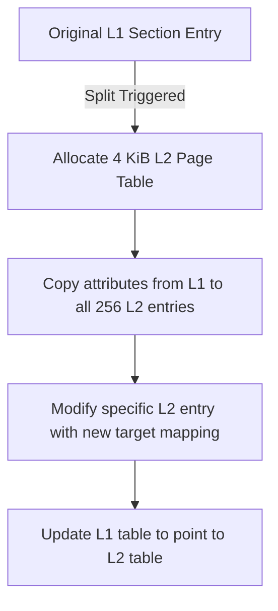
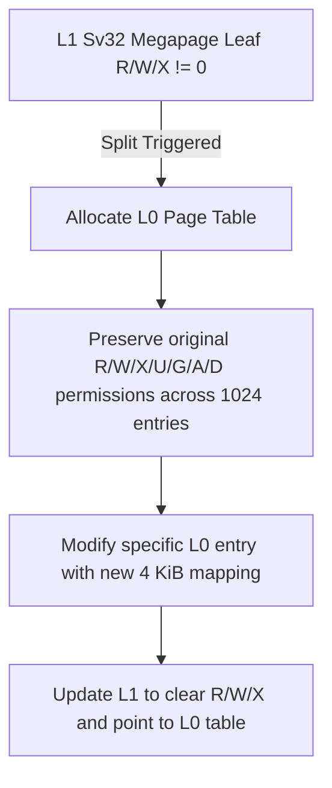

# EDGE32 Memory Management Unit Architecture

This document describes the design and implementation of the MMU-Lite translation backends for ARM32 and RISC-V32 (Sv32) architectures in Bharat-OS. These backends are responsible for implementing page-table operations with `MMU_LITE` isolation characteristics, which are specifically designed for constrained target profiles where memory is highly restricted.

## Overview of MMU-Lite

Unlike a `MMU_FULL` implementation that leverages full process memory isolation and extensive virtual memory capabilities, `MMU_LITE` acts as a structurally constrained boundary optimized for efficiency. The key responsibilities of `MMU_LITE` include:
1. **Eager Mappings**: Avoiding demand paging unless strictly necessary.
2. **Deterministic Table Splitting**: Handling situations where bootstrap windows (which are typically mapped using huge pages/sections) need to be broken down to 4 KiB increments securely.
3. **Firm Isolation Boundaries**: Validating strictly that user-space contexts cannot infer or access kernel/bootstrap physical locations.

## ARM32 Architecture Backend (`hal_pt_arm32.c`)

ARM32 translates virtual addresses using a 2-level short descriptor page table format. The Level 1 (L1) table divides memory into 1 MiB Sections, and the Level 2 (L2) table divides memory into 4 KiB Small Pages.

### Section Splitting

When an allocation requires granular permissions or mapping over a region initially configured as a 1 MiB Section (e.g., during the kernel's bootstrap initialization window), the system must preserve the 1 MiB mapping properties onto a newly allocated L2 page table.

Attributes mapped from the L1 Section to L2 Small Page entries:
- **C/B bits**: Mapped directly (Cacheable, Bufferable).
- **AP bits**: Translated according to kernel-read-only vs writable definitions based on AP[0] and AP[2].
- **XN bit**: Executable Never mappings are preserved in L2 `XN`.

## RISC-V32 (Sv32) Architecture Backend (`hal_pt_riscv32.c`)

RISC-V32 (Sv32) employs a 2-level page table where a Level 1 entry can directly point to a 4 MiB physical memory block (Megapage leaf) if any of the Read, Write, or Execute bits (`R`, `W`, `X`) are set.

### Megapage Leaf Splitting

Similarly to ARM32, if a 4 KiB mapping is requested within an existing 4 MiB Megapage, the `hal_pt_riscv32.c` splits the mapping seamlessly without causing isolation leaks.

### Constraints Enforced
- **Invalid W=1 R=0 Combinations**: Per the Sv32 architectural specification, PTEs cannot be writable but not readable. The kernel rejects `HAL_PT_FLAG_WRITE` requests missing `HAL_PT_FLAG_READ`.

## Address Space Ownership

In both implementations, user-space mappings are distinct, and destroying a user address space reclaims all L2/L0 allocated tables, preventing memory leaks, but strictly leaves the bootstrap window references untouched as they are not explicitly owned by the user process.
