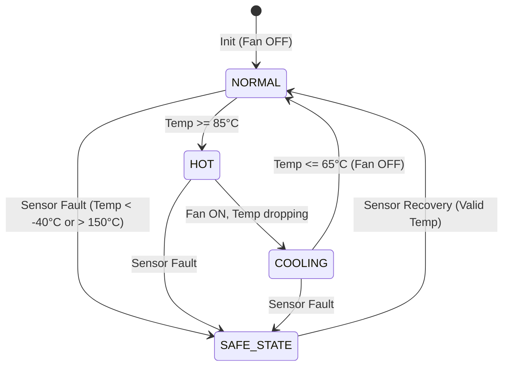

# Bharat-OS Renode ECU Simulation Pipeline

This document describes the automated device simulation pipeline for Antmicro Renode and the reference Automotive Cooling Fan Electronic Control Unit (ECU) workload in Bharat-OS (`BH-RENODE-P0-001`).

```
                    +------------------------------------+
                    |        Declarative Target          |
                    | delivery/targets/renode/*.yaml     |
                    +-----------------+------------------+
                                      |
                                      v
                    +------------------------------------+
                    |       Tools Packaging Stage        |
                    |    tools/package/packager.py       |
                    +-----------------+------------------+
                                      |
                                      v
                    +------------------------------------+
                    |         Renode Runner              |
                    | tools/runners/runner_renode.py     |
                    +-----------------+------------------+
                                      |
                 +--------------------+--------------------+
                 |                                         |
                 v                                         v
   +-----------------------------+           +-----------------------------+
   |   Renode Process (--plain)  |           | TCP Client Socket Reader    |
   |   - mach create             |           | - Connect 127.0.0.1:<port>  |
   |   - LoadPlatformDescription |           | - Real-time UART demux      |
   |   - sysbus LoadELF          | <-------> | - Marker validation         |
   |   - ServerSocketTerminal    |           | - Forbidden marker trap     |
   |   - connector Connect       |           | - Bounded timeout watchdog  |
   +-----------------------------+           +--------------+--------------+
                                                            |
                                                            v
                                             +-----------------------------+
                                             |     Generated Evidence      |
                                             |  - boot.log                 |
                                             |  - {target}_evidence.json   |
                                             +-----------------------------+
```

---

## 1. Architecture & Design

### Microkernel Separation & Placement
- **Kernel Mechanism**: Pure execution scheduling and hardware abstractions. Zero emulator strings or runner logic in `core/kernel/` (enforced by `check_placement.py`).
- **ECU Application Logic**: Resides in `experience/apps/ecu_cooling_fan/`. Operates strictly as an unprivileged application with bounded memory (zero dynamic heap allocation).
- **Simulation Harness**: Automated by `tools/runners/runner_renode.py` using headless TCP socket terminal redirection.

### ECU Cooling Fan State Machine



- **Hysteresis Window**: High threshold = 85°C (turns fan ON); Low threshold = 65°C (turns fan OFF). Prevents rapid actuator cycling in the 66°C–84°C band.
- **Fail-Safe Mechanism**: Out-of-bounds readings (`< -40°C` or `> 150°C`) trip immediately into `SAFE_STATE`. In `SAFE_STATE`, the cooling fan is forced ON to protect the powertrain/battery from overheating.
- **Self-Healing Recovery**: Once verified valid samples resume, the controller logs recovery and transitions back to `NORMAL`.

---

## 2. Target Profiles

The declarative targets are stored in `delivery/targets/renode/`:

| Target Name | Profile Path | Architecture | Machine Model | Status |
|---|---|---|---|---|
| **`arm64_renode_ecu_fan`** | `delivery/targets/renode/arm64_renode_ecu_fan.yaml` | `arm64` | `cortex-a53-gicv2` | **PASS (Executable)** |
| **`stm32f4_discovery`** | `delivery/targets/renode/stm32f4_discovery.yaml` | `arm32` | `stm32f4_discovery` | **BLOCKED (Documented Prerequisite)** |

---

## 3. Physical STM32F4 Migration Prerequisites

The STM32F4 Discovery board features an **ARM Cortex-M4** (ARMv7E-M) microcontroller. Bharat-OS's current ARM32 port is built for **ARM Cortex-A15** (ARMv7-A).

Attempting to run the existing ARM32 kernel directly on STM32F4 fails closed due to physical hardware architectural differences:

| Subsystem | Bharat-OS ARM32 Current Baseline | STM32F4 Discovery Requirement |
|---|---|---|
| **Core Architecture** | ARMv7-A (Cortex-A15, ARM 32-bit state, CP15) | ARMv7E-M (Cortex-M4, Thumb-2 only, no CP15) |
| **Interrupt Controller**| ARM GICv2 (`0x08000000`) | Nested Vectored Interrupt Controller (NVIC, `0xE000E100`) |
| **Memory Map** | Multi-megabyte RAM at `0x40000000` | 1 MB Flash at `0x08000000`, 128 KB SRAM at `0x20000000` |
| **Memory Collision** | Linked text at `0x40010000` (RAM in QEMU `virt`) | `0x40010000` is peripheral I/O space (`gpioPortC` / `usart1`) |
| **Console UART** | ARM PL011 at `0x09000000` | STM32 USART (`USART2` at `0x40004400` / `USART1` at `0x40011000`) |
| **System Timer** | ARM Generic Timer (architected timer) | ARM SysTick (`0xE000E010`) / STM32 Hardware TIM |

### Prerequisites Checklist for Native STM32F4 Bring-Up
1. **Architecture Port**: Create `core/arch/arm/cortex_m/` with Thumb-2 vector table (`_vector_table` with initial SP at `0x08000000` and Reset_Handler at `0x08000004`).
2. **NVIC Driver**: Implement `core/drivers/intc/nvic.c` implementing the HAL IRQ contract.
3. **STM32 UART Driver**: Implement `core/drivers/serial/stm32_uart.c` for `USART1`/`USART2`.
4. **Memory Footprint & Linker**: **COMPLETED (`BH-EMBED-LINK-P0-001`)**. Delivered declarative memory manifest (`platform/boards/stm32f407_discovery/board.yaml`), templated Cortex-M linker generator (`delivery/linker/templates/cortex_m.ld.in`), and link-time MMIO collision detector (`tools/board/validate.py`).

---

## 4. How to Run & Verify

### Using the Nirmaan Developer CLI (Recommended)

```powershell
# 1. Qualify the STM32F407 Discovery board memory manifest and layout
.\nirmaan.ps1 verify --board stm32f407_discovery

# 2. Build the embedded target with static userspace runtime
.\nirmaan.ps1 build stm32f4-renode

# 3. Run the automated ARM64 ECU Cooling Fan simulation under Renode
.\nirmaan.ps1 run --target-yaml delivery/targets/renode/arm64_renode_ecu_fan.yaml --smoke

# 4. Run Renode and board test suites
.\nirmaan.ps1 test board
pytest quality/tests/renode/test_renode_ecu.py -v
pytest quality/tests/tools/test_runner_renode.py -v
```

### Direct Tool Invocations
```bash
# Direct build and packaging
python tools/build.py package --target-yaml delivery/targets/renode/arm64_renode_ecu_fan.yaml

# Direct execution under Renode
python tools/build.py run --target-yaml delivery/targets/renode/arm64_renode_ecu_fan.yaml --smoke
```

---

## 5. Verification Evidence & Output

Execution produces two artifacts in `build/evidence/`:
1. `boot.log`: Raw serial console log streamed from the guest UART.
2. `arm64_renode_ecu_fan_evidence.json`: Machine-readable evidence conforming to repository verification contracts.

Example JSON output:
```json
{
  "target_name": "arm64_renode_ecu_fan",
  "runner": "renode",
  "renode_binary": "C:\\Program Files\\Renode\\bin\\Renode.exe",
  "runtime_result": "PASS",
  "failure_reason": null,
  "required_markers": [
    "BOOT: kernel_main reached",
    "[ECU_FAN] INIT: Cooling fan controller online",
    "[ECU_FAN] STATE=HOT",
    "[ECU_FAN] STATE=COOLING",
    "[ECU_FAN] SENSOR_FAILURE",
    "[ECU_FAN] STATE=SAFE_STATE",
    "[ECU_FAN] SCENARIO_COMPLETE: PASS"
  ],
  "observed_required_markers": [
    "BOOT: kernel_main reached",
    "[ECU_FAN] INIT: Cooling fan controller online",
    "[ECU_FAN] STATE=HOT",
    "[ECU_FAN] STATE=COOLING",
    "[ECU_FAN] SENSOR_FAILURE",
    "[ECU_FAN] STATE=SAFE_STATE",
    "[ECU_FAN] SCENARIO_COMPLETE: PASS"
  ],
  "forbidden_markers": [
    "KERNEL PANIC",
    "EXCEPTION",
    "BOOT_FAIL:",
    "ASSERTION FAILED"
  ],
  "duration_seconds": 3.42,
  "timestamp": "2026-10-15T11:00:00Z"
}
```
